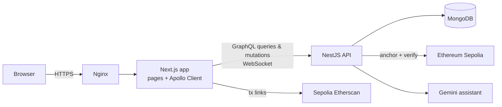

# ChainDepo — Frontend (Next.js · Apollo · TypeScript)

Web app for **[ChainDepo](https://chaindepo.app)**: track freight across Korea, where every tracking event is SHA-256 hash-chained and anchored on Ethereum, and anyone can verify the proof.

Backend: [mirzayv/chaindepo](https://github.com/mirzayv/chaindepo) · Live: https://chaindepo.app

## Features
- **Public tracking** — look up a shipment by tracking code and see its full event timeline.
- **Proof of integrity** — each event shows its hash, the link to the previous hash and the Ethereum Sepolia anchor, so the history can be verified.
- **Route map** — shipment routes on a map of Korea (Leaflet).
- **3D hash-chain scene** — the home page renders the chain with three.js, loaded lazily only when it scrolls into view and paused off screen (respects `prefers-reduced-motion`).
- **Shipper, carrier and admin flows** — create shipments, add tracking events, carrier profiles, admin pages for shipments, users and community.
- **AI assistant & real-time** — floating assistant widget (Gemini, via the backend) and live updates over WebSocket.
- **Community** — articles with a rich-text editor, comments and likes; customer-service page.
- **3 languages** — English, Korean and Russian (`next-i18next`), plus light and dark themes.

## Architecture

The frontend never talks to MongoDB or Ethereum directly: it calls the API, shows each event's hash, previous hash and anchor status, and links to the transaction on Etherscan. Full diagram and the hash-chain flow: [backend README](https://github.com/mirzayv/chaindepo#architecture).

## Tech stack
Next.js · React · TypeScript · Apollo Client (GraphQL + WebSocket subscriptions, token refresh) · MUI · Tailwind CSS / SCSS · Leaflet · three.js · next-i18next · Docker

## Structure
```
pages/            shipment, carrier, community, cs, member, mypage, account, _admin
libs/components/  home, shipment, tracking, carrier, community, admin, layout, ui, widget
apollo/           Apollo Client, cache and WebSocket link
public/locales/   en, kr, ru
```

## Run locally
```bash
yarn install
NEXT_PUBLIC_API_URL=http://localhost:3007/graphql \
NEXT_PUBLIC_API_WS=ws://localhost:3007 \
yarn dev                     # http://localhost:3000
```

## Deployment
Built as a Docker image and served behind Nginx (HTTPS) together with the API on a Google Cloud VM — see the backend repo's `docker-compose.yml`.
